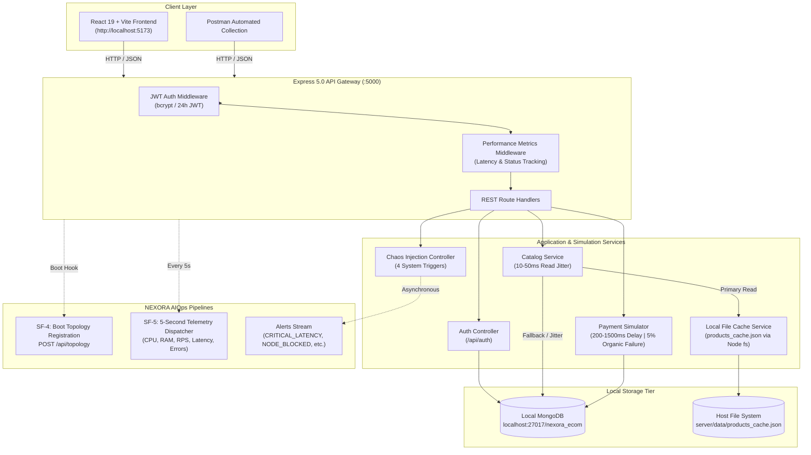

<div align="center">

# ⚡ NEXORA Synthetic E-Commerce Workload
### High-Fidelity Data Generator & Chaos Engineering Platform for AIOps

[](https://nodejs.org/)
[](https://expressjs.com/)
[](https://react.dev/)
[](https://vitejs.dev/)
[](https://www.mongodb.com/)


<p align="center">
  A high-volume, realistic e-commerce application engineered to generate operational telemetry—including <b>metrics, logs, traces, and controlled failure cascades</b>—to train and evaluate external AIOps platforms (such as NEXORA) and their Root Cause Analysis (RCA) models.
</p>

[Quick Start](#-quick-start) •
[Architecture](#-system-architecture) •
[Core Features](#-core-system-features) •
[Chaos Engineering](#-chaos-engineering-module) •
[API Reference](#-api-endpoints) •
[Postman Guide](#-postman-collection)

---

</div>

## 📌 Executive Overview

This repository implements the **Synthetic E-Commerce Workload for NEXORA AIOps** (SRS Version 1.0.0). Built strictly for local infrastructure without external cloud dependencies, it functions as a dual-purpose system:

1. **Consumer-Grade E-Commerce Store**: A flagship tech store featuring real-world product catalogs (smartphones, creator laptops, spatial audio, smartwatches, consoles), detailed hardware specifications, verified customer reviews, dynamic cart calculations, promo code discounts, and simulated multi-step checkout.
2. **Deterministic Telemetry Workload Engine**: An autonomous background pipeline that registers microservice topology, collects operating system and HTTP metrics every 5 seconds, simulates natural network jitter (10–50ms reads, 200–1500ms payment delays, 5% organic error rate), and executes catastrophic failure injection triggers.

---

## 🏗️ System Architecture



---

## 🚀 Quick Start

### Prerequisites
* **Node.js**: v18.0.0 or higher
* **npm**: v9.0.0 or higher
* **MongoDB**: Running locally on `mongodb://127.0.0.1:27017`

### 1. Installation
Clone the repository and install dependencies:
```bash
git clone https://github.com/your-username/Nexora-Ecom-workload.git
cd Nexora-Ecom-workload
npm install
```

### 2. Environment Configuration
The `.env` file is pre-configured for local development. Verify or adjust settings as needed:
```env
# Server Runtime
PORT=5000
NODE_ENV=development

# Database
MONGO_URI=mongodb://127.0.0.1:27017/nexora_ecom

# Security
JWT_SECRET=nexora-synthetic-ecom-secret-key-2026

# NEXORA Staging / Ingestion Endpoints
NEXORA_TOPOLOGY_URL=http://localhost:5000/api/mock-nexora/topology
NEXORA_METRICS_URL=http://localhost:5000/api/mock-nexora/metrics
NEXORA_ALERTS_URL=http://localhost:5000/api/mock-nexora/alerts

# Frontend Base URL
VITE_API_URL=http://localhost:5000
```

### 3. Database Seeding
Populate MongoDB with flagship electronics and default test accounts:
```bash
npm run seed
```

> **Default Test Credentials:**
> * **Email:** `testuser@example.com`
> * **Password:** `SecurePassword123`

### 4. Running the Application
Launch both backend and frontend concurrently with a single command:
```bash
npm run dev:all
```

Alternatively, run each service independently in separate terminals:
```bash
# Terminal 1: Backend API (port 5000)
npm run server

# Terminal 2: Frontend UI (port 5173)
npm run dev
```

Visit **[http://localhost:5173](http://localhost:5173)** in your browser.

---

## 💎 Core System Features

### SF-1: Identity & Access Management
* `POST /api/auth/register`: Hashes passwords locally using `bcryptjs` with 10 salt rounds.
* `POST /api/auth/login`: Issues a signed 24-hour JWT token containing user identity claims.
* Express Middleware (`authenticateJWT`): Validates bearer tokens on all protected routes. Returns structured `401 Unauthorized` responses and logs security exceptions if token signatures are corrupted.

### SF-2: Product Catalog & Dual-Tier Storage
* **Local File Caching (`fs` module)**: Serves static JSON product metadata from disk (`server/data/products_cache.json`) with sub-millisecond I/O.
* **Randomized Read Jitter**: Injects 10ms–50ms artificial database latency per request to simulate organic traffic load variations.
* **Resilient Failover**: If the cache file is absent or corrupted, catalog queries seamlessly fall back to MongoDB (`source: 'database'`) and warm up the local cache asynchronously.
* **Rich Metadata**: Products include category tags, brand, full technical specifications, and verified customer reviews.

### SF-3: Mock Payment Simulator & Checkout
* `POST /api/checkout`: Processes order payloads without external third-party dependencies (e.g., Stripe/PayPal).
* **Network Transit Emulation**: Introduces a simulated latency delay between **200ms and 1500ms** via non-blocking timers.
* **Organic 5% Failure Rate**: Injects a natural 5% error probability returning either `402 Payment Required` (`INSUFFICIENT_FUNDS`) or `504 Gateway Timeout` (`GATEWAY_TIMEOUT`) to establish baseline anomaly training for NEXORA.
* **Transaction Logging**: Successful transactions receive unique authorization references (`PAY-XXXXX`) and persist completed orders in MongoDB.

### SF-4: Microservice Topology Pipeline
On boot, the backend server executes a startup POST request to the configured NEXORA topology endpoint declaring the microservice graph relationships:
```json
{
  "application": "ecom-synthetic-workload",
  "environment": "local-dev",
  "topology": {
    "services": [
      { "id": "api-gateway", "type": "gateway", "target": "localhost:5000" },
      { "id": "auth-service", "type": "service", "dependencies": ["mongodb-local"] },
      { "id": "catalog-service", "type": "service", "dependencies": ["mongodb-local", "fs-cache"] },
      { "id": "checkout-service", "type": "service", "dependencies": ["payment-simulator", "mongodb-local"] },
      { "id": "payment-simulator", "type": "mock-service", "dependencies": [] },
      { "id": "mongodb-local", "type": "database", "target": "localhost:27017" },
      { "id": "fs-cache", "type": "storage", "target": "local-disk" }
    ],
    "edges": [
      { "from": "api-gateway", "to": "auth-service" },
      { "from": "api-gateway", "to": "catalog-service" },
      { "from": "api-gateway", "to": "checkout-service" },
      { "from": "auth-service", "to": "mongodb-local" },
      { "from": "catalog-service", "to": "mongodb-local" },
      { "from": "catalog-service", "to": "fs-cache" },
      { "from": "checkout-service", "to": "payment-simulator" },
      { "from": "checkout-service", "to": "mongodb-local" }
    ]
  }
}
```

### SF-5: Telemetry Dispatcher (Background Worker)
* Runs as a non-blocking worker aggregating operational metrics every **5 seconds**.
* Dispatches HTTP request throughput (RPS), response times (min, max, avg), error counts (4xx / 5xx), CPU usage, and Memory stats (Heap Used/Total, RSS via Node `os` and `process` modules).
* **Fail-Safe Mode**: If the NEXORA ingestion endpoint is unreachable, telemetry packets are dropped immediately without buffering, preventing application memory leaks and backpressure.

---

## 💥 Chaos Engineering Module

The application provides four dedicated endpoints to intentionally sabotage system integrity and train NEXORA's Root Cause Analysis (RCA) models:

| Trigger | Endpoint | Injected Failure | Resulting Cascade & NEXORA Alert |
| :--- | :--- | :--- | :--- |
| **Trigger 1** | `POST /api/chaos/payment-timeout` | Forces `PaymentSimulator` to hang for **30,000ms** on the next 50 checkout requests. | Clients receive **504 Gateway Timeout**. Telemetry captures a latency spike and 5xx surge, emitting a `CRITICAL_LATENCY` alert to NEXORA. |
| **Trigger 2** | `POST /api/chaos/db-drop` | Forcefully closes the Mongoose/MongoDB connection pool for **60 seconds**. | Catalog and auth queries throw `MongoNotConnectedError` (HTTP 503). NEXORA logs a broken edge between `catalog-service` and `mongodb-local`. Auto-reconnects in 60s. |
| **Trigger 3** | `POST /api/chaos/cpu-spike` | Executes a synchronous computationally heavy while-loop for exactly **10 seconds**. | Blocks the Node.js single-threaded event loop. All incoming HTTP requests queue. NEXORA receives a `NODE_EVENT_LOOP_BLOCKED` metric and sharp drop in RPS. |
| **Trigger 4** | `POST /api/chaos/fs-fault` | Renames/disables the product cache JSON file for **30 seconds**. | Cache reads throw `ENOENT` exceptions. Catalog automatically falls back to MongoDB (`source: 'database'`). NEXORA logs a spike in storage-layer exceptions. Auto-restores in 30s. |

> **Interactive Control:** Visit **`/admin/chaos`** in the web interface to trigger, monitor countdown timers, or reset any active chaos trigger with a single click.

---

## 📡 API Endpoints

### Health & Monitoring
| Method | Endpoint | Auth | Description |
| :--- | :--- | :---: | :--- |
| `GET` | `/health` | No | Returns system uptime, MongoDB state, file cache state, and memory consumption. |
| `GET` | `/api/mock-nexora/data` | No | In-memory inspector showing ingested topology, metrics batches, and alerts. |

### Authentication
| Method | Endpoint | Auth | Description |
| :--- | :--- | :---: | :--- |
| `POST` | `/api/auth/register` | No | Registers user with username, email, and password. Returns user object. |
| `POST` | `/api/auth/login` | No | Validates credentials and returns signed 24-hour JWT token. |

### Product Catalog
| Method | Endpoint | Auth | Description |
| :--- | :--- | :---: | :--- |
| `GET` | `/api/products` | Yes | Retrieves paginated products. Query params: `page`, `limit`, `category`, `search`, `sortBy`. |
| `GET` | `/api/products/:id` | Yes | Retrieves detailed product information including technical specifications and reviews. |

### Checkout & Payments
| Method | Endpoint | Auth | Description |
| :--- | :--- | :---: | :--- |
| `POST` | `/api/checkout` | Yes | Processes cart items via simulated payment engine. Returns `orderId` and `paymentRef`. |

### Chaos Engineering
| Method | Endpoint | Auth | Description |
| :--- | :--- | :---: | :--- |
| `POST` | `/api/chaos/payment-timeout` | Yes | Arms 30-second hang on next 50 checkout requests. |
| `POST` | `/api/chaos/db-drop` | Yes | Drops MongoDB connection pool for 60 seconds. |
| `POST` | `/api/chaos/cpu-spike` | Yes | Blocks Node.js event loop for 10 seconds. |
| `POST` | `/api/chaos/fs-fault` | Yes | Sabotages filesystem cache for 30 seconds. |
| `POST` | `/api/chaos/reset` | Yes | Resets all active chaos conditions back to nominal. |

---

## 📦 Postman Collection

An official, ready-to-run Postman collection is included in the repository:
* **Path:** [`postman/NEXORA_Ecom_Workload.postman_collection.json`](./postman/NEXORA_Ecom_Workload.postman_collection.json)

### Import & Testing Instructions:
1. Open Postman and click **Import**.
2. Select `postman/NEXORA_Ecom_Workload.postman_collection.json`.
3. Ensure the collection variable `{{base_url}}` is set to `http://localhost:5000`.
4. Execute the **Authentication > Login** request. The test script will automatically capture the returned JWT and populate the `{{token}}` variable for all subsequent protected requests.
5. Execute requests under **Product Catalog**, **Checkout**, and **Chaos Engineering** to test the system endpoints.

---

## 🛠️ Project Structure

```
Nexora-Ecom-workload-main/
├── postman/
│   └── NEXORA_Ecom_Workload.postman_collection.json   # Postman collection
├── server/
│   ├── config/
│   │   └── db.js                 # MongoDB connection & chaos drop logic
│   ├── data/
│   │   └── products_cache.json   # Local fs cache metadata
│   ├── middleware/
│   │   ├── auth.js               # JWT authentication middleware
│   │   └── metricsMiddleware.js  # Request duration & status tracking
│   ├── models/
│   │   ├── Order.js              # Order schema & transaction status
│   │   ├── Product.js            # Product schema with specs & reviews
│   │   └── User.js               # User authentication schema
│   ├── routes/
│   │   ├── authRoutes.js         # Register & Login routes
│   │   ├── chaosRoutes.js        # 4 Chaos injection endpoints + Reset
│   │   ├── checkoutRoutes.js     # Checkout & order processing
│   │   ├── healthRoutes.js       # System health monitor route
│   │   ├── mockNexoraRoutes.js   # Local test ingestion routes
│   │   └── productRoutes.js      # Catalog querying & filtering
│   ├── services/
│   │   ├── cacheService.js       # Node fs caching & ENOENT fault injector
│   │   ├── paymentSimulator.js   # Latency delay, 5% failure & 30s timeout
│   │   ├── telemetryDispatcher.js# 5-second background metrics worker
│   │   └── topologyService.js    # Startup microservice graph mapper
│   ├── index.js                  # Express application entrypoint
│   └── seed.js                   # Mock product & test user database seeder
├── src/
│   ├── api/
│   │   └── axios.js              # Axios HTTP client with JWT interceptor
│   ├── components/
│   │   ├── ChaosCard.jsx         # Failure trigger card with countdown
│   │   ├── Navbar.jsx            # Store navigation, search & telemetry links
│   │   ├── ProductCard.jsx       # E-commerce card with ratings & badges
│   │   └── ProductModal.jsx      # Specs & reviews quick-view modal
│   ├── context/
│   │   ├── AuthContext.jsx       # User authentication state provider
│   │   └── CartContext.jsx       # Shopping cart, promo & shipping state
│   ├── pages/
│   │   ├── Cart.jsx              # Cart page with promo code calculations
│   │   ├── ChaosAdmin.jsx        # Chaos Engineering command center
│   │   ├── Checkout.jsx          # Multi-step checkout simulator
│   │   ├── Health.jsx            # Real-time AIOps health dashboard
│   │   ├── Login.jsx             # User authentication page with demo fill
│   │   ├── Products.jsx          # Catalog browser with category filters
│   │   └── Register.jsx          # Account registration page
│   ├── App.jsx                   # Application router & protected routes
│   ├── index.css                 # Design system tokens & utility classes
│   └── main.jsx                  # React DOM root entrypoint
├── .env                          # Local environment variables
├── .env.example                  # Environment template
├── package.json                  # Root npm configuration & scripts
└── vite.config.js                # Vite build configuration
```

---

## 📜 License & Compliance

Designed and implemented in compliance with the **NEXORA AIOps Synthetic Workload SRS v1.0.0**. Strictly restricted to local execution—zero external cloud infrastructure required.
